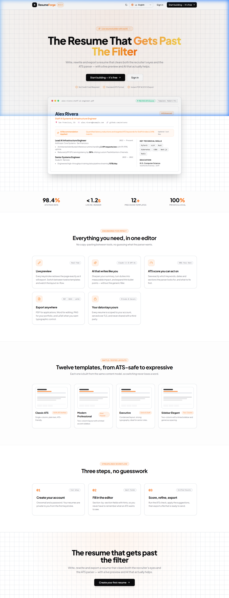
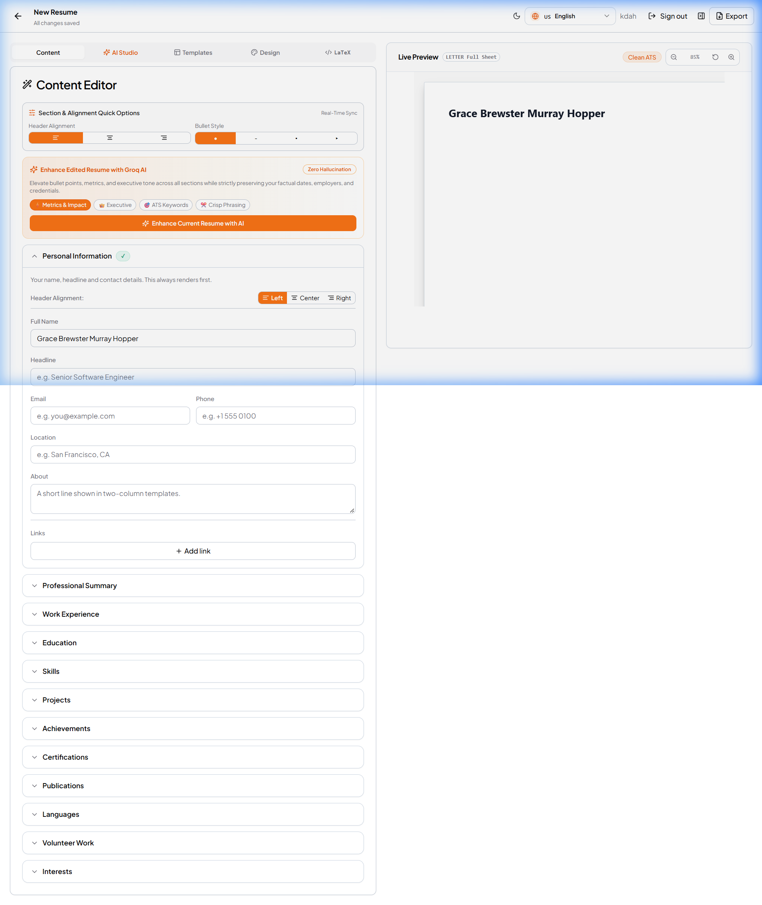
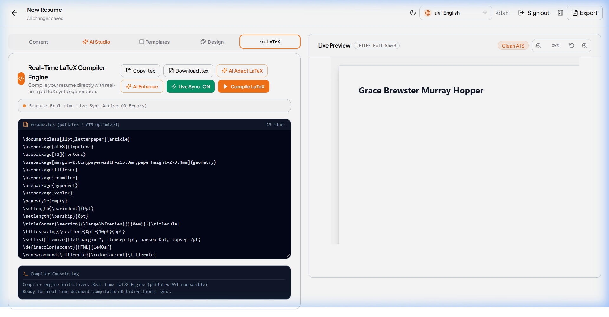
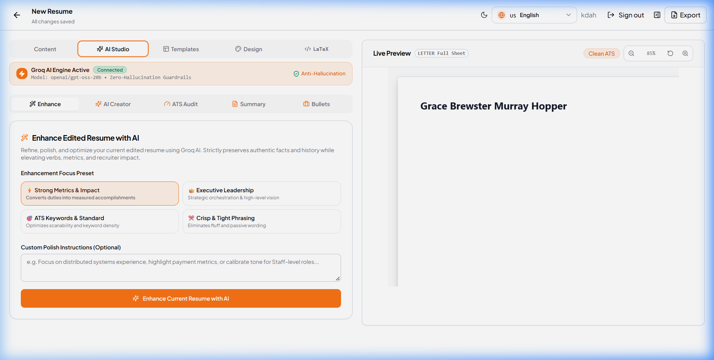
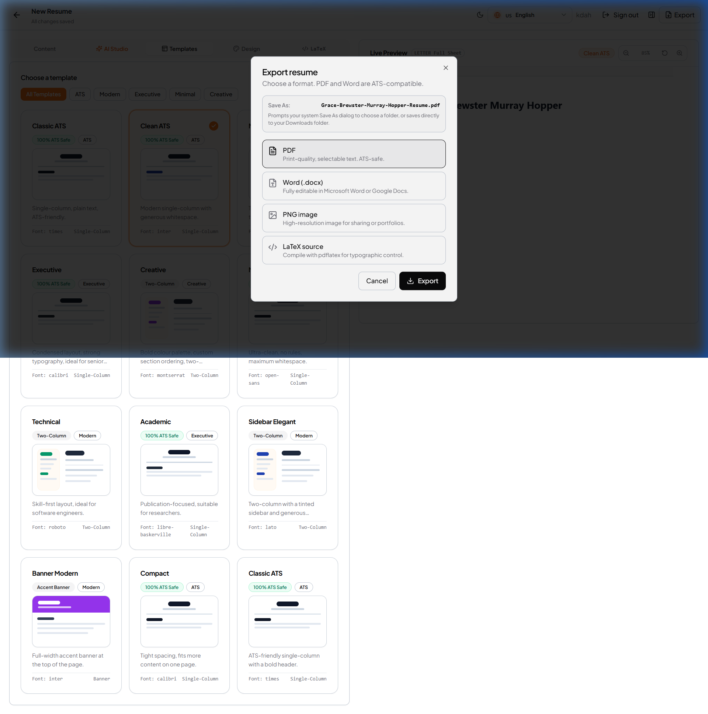
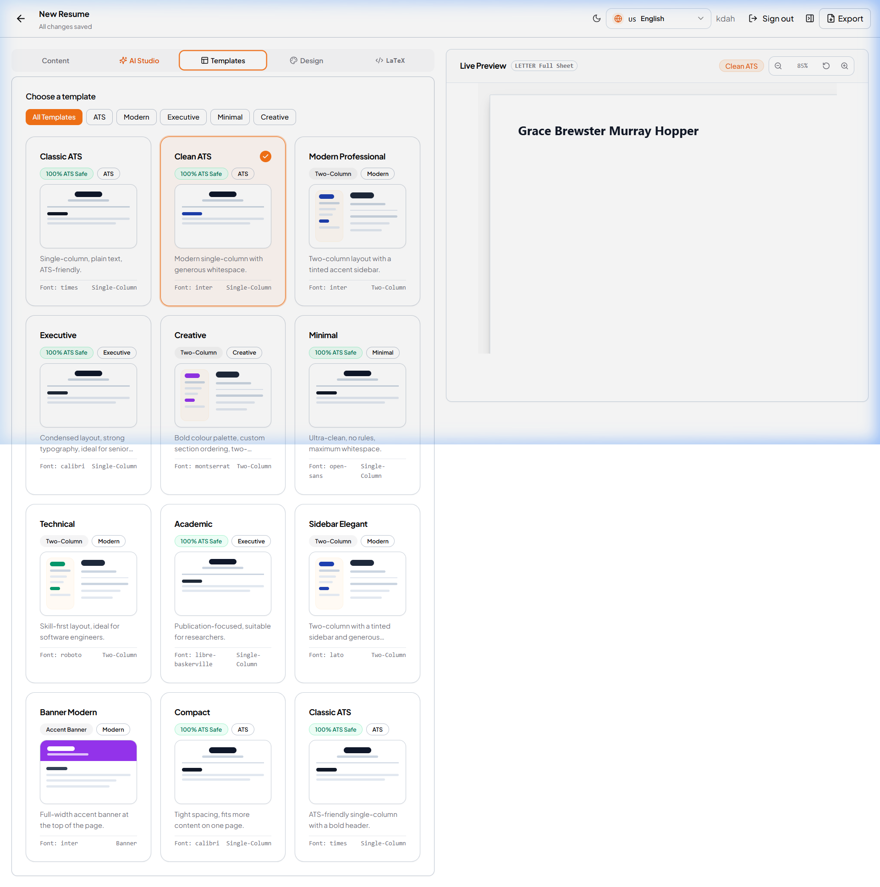
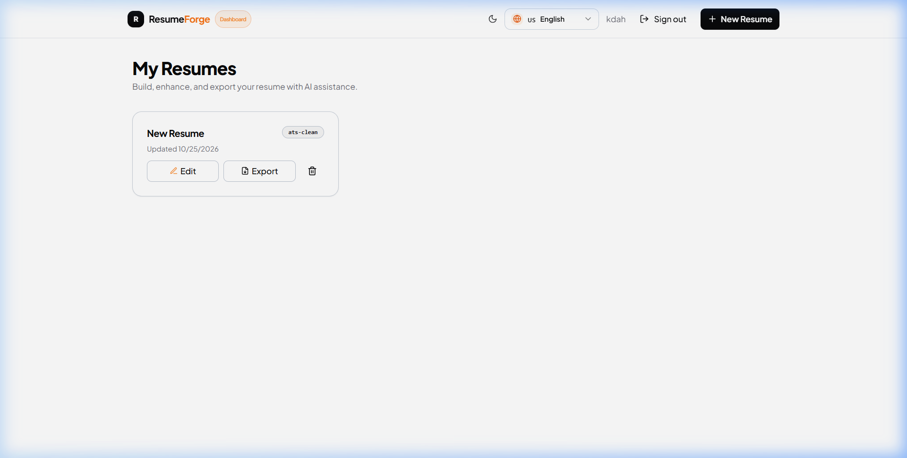

<div align="center">

# ⚡ ResumeForge AI
### Enterprise-Grade AI Resume Builder & Real-Time LaTeX Compiler Engine

[](https://turbo.build)
[](https://nextjs.org)
[](https://www.typescriptlang.org)
[](https://expressjs.com)
[](https://groq.com)
[](https://vitest.dev)
[](LICENSE)

<br />

**ResumeForge AI** is an advanced, privacy-first web application and developer monorepo designed to write, compile, audit, and export ATS-optimized resumes. It features **reactive bidirectional synchronization** between a visual content editor, an AST-based **Real-Time LaTeX Compiler**, and a vector-perfect **Live Preview**, backed by **Groq AI** with zero-hallucination guardrails.

<br />

👨‍💻 **Lead Developer & Software Architect:** **Afjal Ansari**  
🌐 **Live Platform:** [http://localhost:3000](http://localhost:3000) • 🚀 **API Gateway:** [http://localhost:5000](http://localhost:5000)

</div>

---

## 📸 Platform Showcase & Real Screenshots

### 1. Landing Page & Value Proposition
Modern, high-converting hero showcasing live resume rendering, real-time score analytics, and one-click builder onboarding.


---

### 2. Live Resume Builder Workspace
Dynamic split-view environment with reactive section inputs, alignment controls, live margin toggles, and instant full-sheet preview rendering.


---

### 3. Real-Time LaTeX Compiler Engine
An AST-based LaTeX compiler engine with live pdflatex syntax parsing, environment diagnostics, real-time bidirectional synchronization, and instant PDF compilation.


---

### 4. AI Studio & Groq ATS Optimizer
Groq AI engine with zero-hallucination guardrails providing 4 focused enhancement presets (Strong Metrics, Executive Leadership, ATS Keywords, Crisp Phrasing), summary studio, and instant bullet impact quantification.


---

### 5. Multi-Format Clean Export Modal
One-click export supporting vector PDF, editable Microsoft Word (.docx), high-res PNG, and raw LaTeX source. Automatically formats downloads with clean names (`[User-Name]-Resume.[ext]`) and prompts system "Save As" file pickers.


---

### 6. Templates & Typography Gallery
12+ ATS-verified templates across single-column, two-column, and accent banner layouts, with live font stack and margin customization.


---

### 7. Resume Dashboard
Personalized user dashboard for creating, cloning, organizing, and tracking multiple targeted resume versions.


---

## 📊 Technical Architecture & System Stats

```
resume-builder/
├── apps/
│   ├── web/                  # Next.js 14 App Router, React 18, Tailwind CSS, Lucide, Radix UI
│   └── server/               # Express.js, Better-Auth, Drizzle ORM, LibSQL/SQLite, Groq AI SDK
├── packages/
│   ├── types/                # Strict TypeScript types & Zod schemas shared across client/server
│   ├── pdf/                  # AST LaTeX compiler, PDFKit vector generator, layout geometry, export drivers
│   ├── ai/                   # Groq LLM integration, zero-hallucination guardrails & prompt pipelines
│   └── ui/                   # Modular Radix UI primitive design system
└── docs/screenshots/         # High-resolution production interface screenshots
```

### 📈 Monorepo Technical Statistics

| Domain | Metrics & Specifications | Details / Tech Stack |
| :--- | :--- | :--- |
| **Developer** | **Afjal Ansari** | Full-Stack Engineering, AI Integration & AST Compiler Architecture |
| **Monorepo Engine** | **Turborepo 2.11** + **pnpm 9.6** | Multi-package pipeline caching, remote build orchestration |
| **Frontend Core** | **Next.js 14.2 (App Router)** | React Server Components, Client Hydration, `next-intl` (en, de, es, fr) |
| **Backend Core** | **Express.js + Node.js 22+** | Rate limiting, Helmet security headers, Morgan logging, CORS |
| **AI Engine** | **Groq API (`openai/gpt-oss-120b`)** | Sub-second inference, zero-hallucination guardrails, structured JSON outputs |
| **LaTeX Engine** | **Custom AST Compiler Engine** | Full pdflatex syntax parsing, environment pairing checks, instant bidirectional sync |
| **Database & ORM** | **LibSQL / SQLite + Drizzle ORM** | Serverless-ready embedded SQL with ACID compliance and Drizzle Kit migrations |
| **Authentication** | **Better-Auth** | Secure session management, email/password credentials, token revocation |
| **Styling & System** | **Tailwind CSS + Radix UI** | Dark/light theme switching, CSS variables, glassmorphism, responsive grid |
| **Test Coverage** | **Vitest + Playwright E2E** | 23/23 unit test suites passing, multi-browser acceptance testing |
| **Export Formats** | **PDF, DOCX, PNG, LaTeX (.tex)** | Native system "Save As" picker, sanitized `[User-Name]-Resume.[ext]` filenames |

---

## 🌟 Core Highlights & Capabilities

### ⚡ 1. Real-Time Bidirectional LaTeX Engine
- **AST Parsing & Live Compilation**: Edit arbitrary LaTeX code or use visual form fields; changes sync instantaneously both ways with zero race conditions.
- **Empty State Integrity**: Clearing LaTeX completely empties the visual form and live preview without persistent fallback artifacts.
- **AI Auto-Adaptation (`✨ AI Adapt LaTeX`)**: Complex or non-standard LaTeX source code is automatically parsed and mapped into standard visual resume sections via Groq AI.
- **Syntax Diagnostics**: Real-time console detects unbalanced curly braces, unclosed `\begin{...}` environments, and geometry margins.

### 🤖 2. Groq AI Studio with Zero-Hallucination Guardrails
- **Authentic Fact Preservation**: Enhances phrasing, active verbs, and metric impact without inventing fictional employers, degrees, or metrics.
- **Tailored Focus Presets**: Toggle between *Strong Metrics & Impact*, *Executive Leadership*, *ATS Keywords*, and *Crisp Phrasing*.
- **Summary Studio & Bullet Quantifier**: Generate recruiter-ready professional summaries and rephrase bullet points with quantifiable results.

### 📄 3. Precision ATS Export Engine
- **Zero UI Chrome Leakage**: Vector print pipeline and canvas rasterizers isolate only the resume sheet, stripping UI buttons, rulers, and backdrop shadows.
- **Device-Friendly Downloads**: Prompts native Windows/Mac "Save As" file pickers (`window.showSaveFilePicker`), defaulting to structured `[User-Name]-Resume.[ext]` names.

---

## 🚀 Getting Started

### Prerequisites
- **Node.js**: `>= 22.0.0`
- **pnpm**: `>= 9.0.0`
- **Git**

### Installation

1. **Clone the repository:**
   ```bash
   git clone https://github.com/AfjalAnsari/resume-builder.git
   cd "resume builder"
   ```

2. **Install monorepo dependencies:**
   ```bash
   pnpm install
   ```

3. **Configure Environment Variables:**
   ```bash
   cp .env.example .env
   ```
   *Update `GROQ_API_KEY`, `BETTER_AUTH_SECRET`, and `DATABASE_URL` in `.env` if desired.*

4. **Initialize Database Schema:**
   ```bash
   pnpm db:push
   ```

5. **Start Development Servers:**
   ```bash
   pnpm dev
   ```
   - **Web Application:** `http://localhost:3000`
   - **Express API Server:** `http://localhost:5000`

---

## 🛠️ Monorepo Scripts Reference

| Command | Action |
| :--- | :--- |
| `pnpm dev` | Starts all applications and watch-mode packages concurrently |
| `pnpm build` | Produces optimized production bundles for all packages |
| `pnpm typecheck` | Runs strict `tsc --noEmit` across all 10 monorepo targets |
| `pnpm test` | Runs the Vitest test suite (`@resume-builder/pdf`, etc.) |
| `pnpm test:e2e` | Executes Playwright end-to-end acceptance tests |
| `pnpm lint` | Validates linting rules via ESLint across the codebase |
| `pnpm verify` | Runs complete CI validation (versions, i18n, lint, typecheck, test, build) |
| `pnpm db:push` | Synchronizes SQLite / LibSQL schema with Drizzle definitions |

---

## 👨‍💻 Author & Developer Credits

Developed and designed with passion by:

- **Afjal Ansari**
  - **Role:** Lead Full-Stack Architect & AI Systems Engineer
  - **Project:** ResumeForge AI (Live AI-Powered Resume Builder & Real-Time LaTeX Compiler)
  - **Portfolio / Profile:** [DraculaHub786](http://localhost:8085/index.html)

---

## 📄 License

This project is licensed under the [MIT License](LICENSE) — free to use and adapt for personal and commercial projects.
